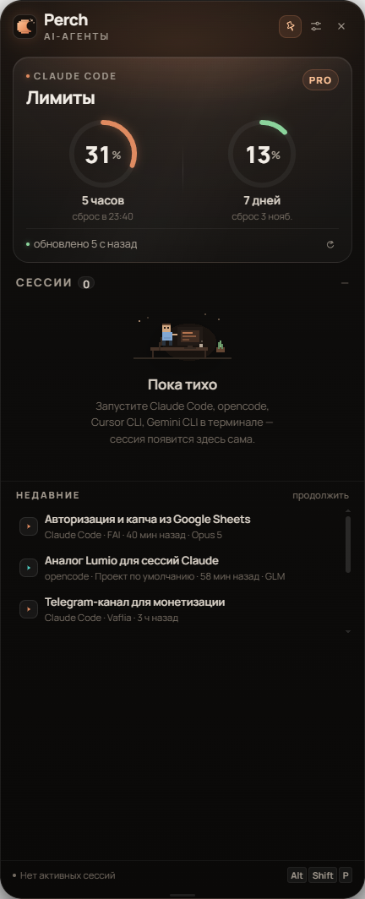

# Perch

**Perch** — «шторка» у края экрана для Windows, которая следит за вашими локальными CLI-агентами
(**Claude Code**, **opencode**, **Cursor CLI**, **Codex CLI**, **Gemini CLI**): активные сессии,
живые таймеры, заполнение контекста, последнее действие и лимиты Claude.



Perch ничего не устанавливает за вас: он только **читает локальные файлы** уже установленных агентов.
Нет агентов — нет сессий; в настройках видно, кто найден на компьютере, а кого нужно поставить самому.

## Что умеет

- **Сессии нескольких агентов сразу.** Claude Code, opencode, Cursor CLI, Codex CLI и Gemini CLI
  в одном списке, каждый со своей цветной меткой. Интерактивные и фоновые (`bg`) сессии.
- **Лимиты Claude Code** — 5-часовое окно и недельный лимит с кольцами прогресса и временем сброса.
  Данные берутся из того же OAuth-эндпоинта, что использует сам Claude Code.
- **Время работы** — живой таймер каждой сессии, время последней активности, модель и контекст.
- **Прогресс контекста** — тонкая полоса заполнения контекстного окна.
- **Последнее действие** — инструмент, команда или последний ответ прямо сейчас.
- **Шторка** — открывается наведением, закрепляется кликом. Сторона (слева/справа), высота и ширина
  настраиваются слайдерами или перетаскиванием нижнего края.
- **Окно можно перемещать** — потяните шторку за верхнюю панель; позиция запоминается между запусками
  (кнопка «Сбросить положение окна» в настройках возвращает её к краю).
- **Темы оформления** — Perch, Midnight, Graphite и Daylight (светлая).
- **Размер шрифта** — ползунок от 100 % до 160 %.
- **Статус** — работает / готово / ждёт ответа. Капсула подсвечивается, когда сессии нужен ваш ответ.
- **Трей** — иконка с быстрым меню, горячая клавиша `Alt + Shift + P`, уведомления, автозапуск.

## Поддерживаемые агенты

Perch определяет агента по его локальным данным. Установку каждый агент выполняет сам — Perch лишь
подсказывает команду в настройках (раздел **Агенты**).

| Агент | Что читает Perch | Как поставить | Продолжить сессию |
| --- | --- | --- | --- |
| **Claude Code** | `~/.claude/sessions/*.json`, `~/.claude/projects/**/*.jsonl` | `npm i -g @anthropic-ai/claude-code` | `claude --resume <id>` |
| **opencode** | `~/.local/share/opencode/opencode.db` | `npm i -g opencode-ai` | `opencode --session <id>` |
| **Cursor CLI** | `~/.cursor/projects/<slug>/agent-transcripts/<id>/<id>.jsonl` | `npm i -g cursor-agent` | открывает папку проекта |
| **Codex CLI** | `~/.codex/sessions/**/rollout-*.jsonl` | `npm i -g @openai/codex` | `codex resume <id>` |
| **Gemini CLI** | `~/.gemini/tmp/<hash>/chats/*.json`, `~/.gemini/antigravity/conversations/conversation_summaries.db` | `npm i -g @google/gemini-cli` | открывает папку проекта |

> Лимиты (5 часов / 7 дней) умеет отдавать только Claude Code — у остальных агентов Perch показывает
> сессии, модель, контекст и время.

## Установка

Готовые сборки — в разделе **Releases**:

- `Perch-Windows-<версия>.exe` — portable, запускается без установки;
- `Perch-Setup-<версия>.exe` — установщик с ярлыками, автозапуском и пунктом в меню «Пуск».

## Запуск из исходников

```bat
npm install
npm start
```

Electron — единственная крупная зависимость; нативных модулей нет.

## Сборка

```bat
npm run dist
```

Артефакты появятся в `dist/` (`Perch-Windows-*.exe` и `Perch-Setup-*.exe`).

## Настройки

Шестерёнка в заголовке шторки открывает настройки:

- **Шторка** — сторона экрана, высота (40–96 % рабочей области), ширина (360–480 px);
- **Оформление** — тема, размер шрифта, сброс положения окна;
- **Агенты** — кто найден на компьютере и как поставить остальных;
- **Лимиты** — «Лимиты из Claude Code» (мост через строку статуса, если API недоступен);
- **Поведение** — поверх всех окон, скрывать при уходе курсора, открывать при ожидании ответа,
  показывать контекст;
- **Уведомления** — сообщать о завершении, запускать при входе.

Конфиг хранится в `%APPDATA%\Perch\config.json`.

## Как это работает и что с приватностью

Perch не требует аккаунта и не отправляет ваш код. Он читает только локальные файлы перечисленных
агентов, а токен Claude Code открывается исключительно в главном процессе Electron и никогда не
попадает в интерфейс. Наружу уходит единственный запрос — за процентами лимитов к Anthropic, тем же
OAuth-токеном, что использует сам Claude Code.

Список сессий обновляется каждые 1,5 секунды, лимиты — раз в минуту (и по кнопке обновления).
Сессия считается активной, пока жив процесс соответствующего агента.

## Совместимость

- Windows 10/11, x64.
- Проверено на Electron 45 (Node 24 внутри).
- Кодировка файлов и путей — UTF-8; интерфейс на русском.

## Ограничения

- Статус «ждёт ответа» определяется по состоянию сессии и отсутствию активности более 4 минут;
  полноценный перехват permission-диалогов агентов в Windows-терминале не делается.
- Клик по папке открывает проводник, а не фокусирует конкретное окно терминала (в Windows процесс
  CLI обычно не владеет видимым окном).
- Для лимитов нужен вход в Claude Code. Если токен истёк — откройте Claude Code, он обновит его сам.

## Примечание

Это независимый проект. Он не связан с Anthropic, opencode, Cursor, OpenAI или Google.

## Лицензия

[MIT](LICENSE)
